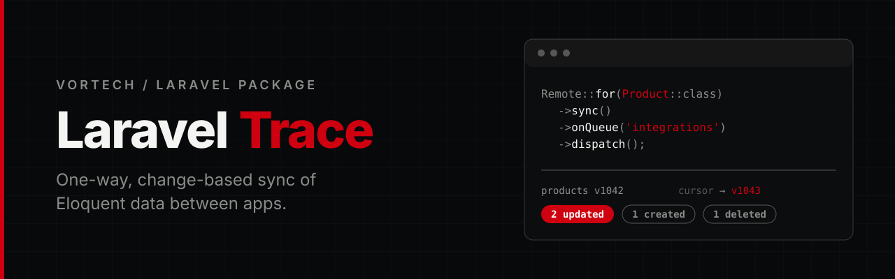

<p align="center">
  
</p>

<p align="center">
  <a href="https://github.com/Vortech-Group/trace/actions/workflows/tests.yml"></a>
  <a href="https://packagist.org/packages/vortech/laravel-trace"></a>
  <a href="https://packagist.org/packages/vortech/laravel-trace"></a>
  <a href="https://packagist.org/packages/vortech/laravel-trace"></a>
  
  <a href="LICENSE.md"></a>
</p>

<p align="center">
  Sync published <strong>Eloquent data</strong> from one Laravel application into another, <strong>one way</strong>, by pulling only what changed.<br>
  An explicit field whitelist, a commit-ordered change log and safe local soft deletes.
</p>

---

## Why

Copying data between two applications usually ends in a nightly full export, or in a webhook that fires inside a model event and is lost when the request fails. Trace gives the source a small authenticated feed and gives the remote a resumable, idempotent pull.

| | Nightly export / model-event webhook | Trace |
|---|---|---|
| What leaves the source | whatever the serializer returns | only the fields you whitelist |
| Change is lost when the call fails | yes | no, it is a durable row in the same transaction |
| Cursor can skip a slow transaction | with auto-increment ids, yes | no, versions are assigned under a row lock in commit order |
| Interrupted first import | starts over | resumes from the last committed page |
| Run twice | duplicates or needless writes | same rows, no `UPDATE` for unchanged values |
| Record deleted at the source | hard delete, or nothing | local soft delete, only for records Trace linked |
| Source vanishes or is replaced | quietly overwritten | `instance_id` mismatch is a hard failure |
| `remote_id` column on your table | usually | never, links live in `trace_links` |

> **Trace is not database level CDC.** It follows Eloquent model events. Writes that fire none (mass updates, `DB::table()`, raw SQL, imports) are not logged; a full reconcile repairs them. Delivery is at-least-once with idempotent application, never exactly-once.

## Requirements

- PHP 8.4+
- Laravel 13+
- On the remote: a cache store with atomic locks (redis, database, file, memcached) and a queue for `dispatch()`
- MySQL 8+, PostgreSQL (SQLite for development and the basic test suite)

## Installation

```bash
composer require vortech/laravel-trace
```

The service provider and the `Remote` facade are registered through package discovery. Then prepare the side(s) the application plays:

```bash
php artisan trace:install            # asks which side(s) this application plays
php artisan trace:install --source   # publishes the config and the source migration
php artisan trace:install --remote   # publishes the config and the remote migration
php artisan migrate
```

Without a flag the command shows a prompt where you pick Source, Remote or both. In a non-interactive run (`--no-interaction`, CI) a flag is required.

Use `--force` to overwrite an existing config file. The tags `trace-config`, `trace-source-migrations` and `trace-remote-migrations` are also available through `vendor:publish`.

## Quickstart

### Source application

```dotenv
TRACE_SOURCE_TOKEN=long-random-secret
```

Mark the model. There is no trait and no interface:

```php
use Vortech\Trace\Attributes\Traceable;

#[Traceable]
class Clinic extends Model
{
    use SoftDeletes;
}
```

Describe what is published (`php artisan trace:make-source ClinicSource`). `$fields` is the whitelist: nothing else ever leaves the application, and hidden attributes, passwords, tokens and the primary key are refused.

```php
use Vortech\Trace\Source;

final class ClinicSource extends Source
{
    protected string $model = Clinic::class;

    protected array $fields = ['code', 'name', 'address', 'phone', 'email', 'city', 'postal_code', 'is_active'];
}
```

Register the feed in `routes/api.php`:

```php
Route::source('clinics', ClinicSource::class);
// GET /api/clinics/snapshot  full data, paged, for the first import and reconciles
// GET /api/clinics/changes   what changed after a cursor
```

Write through transactions, so a change and its log row commit or roll back together:

```php
DB::transaction(fn () => $clinic->update(['name' => 'Central Clinic']));
```

### Remote application

```dotenv
TRACE_REMOTE_URL=https://source.example.com/api
TRACE_REMOTE_TOKEN=long-random-secret
```

Declare the receiving model. `SoftDeletes` is required, because Trace only ever soft deletes.

```php
use Vortech\Trace\Attributes\Sync;

#[Sync(source: 'clinics', mapper: ClinicMapper::class)]
class Clinic extends Model
{
    use SoftDeletes;
}
```

Map the fields (`php artisan trace:make-mapper ClinicMapper`):

```php
use Vortech\Trace\Mapper;

final class ClinicMapper extends Mapper
{
    public function fields(): array
    {
        return [
            'name',                       // same name on both sides
            'address',
            'phone' => 'phone_number',    // remote attribute => local column
            'is_active' => 'active',
        ];
    }

    public function match(): array
    {
        return ['code' => 'clinic_code'];   // finds an existing local row before it has a link
    }

    public function transform(array $mapped): array   // receives local column names
    {
        return $mapped;
    }
}
```

Run it:

```php
use Vortech\Trace\Facades\Remote;

$result = Remote::for(Clinic::class)->sync()->run();                        // SyncResult
Remote::for(Clinic::class)->sync()->dispatch();                             // queued
Remote::for(Clinic::class)->sync()->onQueue('integrations')->dispatch();
Remote::for(Clinic::class)->reconcile()->run();                             // full state comparison

$result->created; $result->updated; $result->unchanged; $result->deleted; $result->restored;
$result->durationMs; $result->cursor;
```

`sync()` only describes the operation; `run()` and `dispatch()` are the terminal calls. `dispatch()` returns a `PendingDispatch`, not a `SyncResult`.

## How it works

### The source change log

One synchronous wildcard listener sees `created`, `updated`, `deleted` and `restored` of every `#[Traceable]` model (checked by Reflection, cached) and writes a row to `trace_changes`. It locks the model's `trace_streams` row (`SELECT ... FOR UPDATE`), increments `version` and inserts the change in the same transaction. A higher version therefore cannot commit before a lower one, which is what makes a cursor safe.

The log stores only the key and `changed` / `deleted`. The API answers with the **current state** of the record, or a `delete` tombstone when it is gone. This is a state-convergence feed, not an event replay: a key may appear more than once in a response and the remote applies it idempotently. A restore is an `upsert`. A force delete fires `deleted` first and is logged exactly once.

### The protocol

`GET {feed}/snapshot?limit=500&cursor=...` returns `data[] = {key, attributes}` and `meta = {protocol, instance_id, feed, schema_hash, watermark, next_cursor, has_more}`. Paging is keyset by primary key, never `OFFSET`. The cursor is opaque, HMAC-signed with `app.key`, expires, and carries the watermark taken at the start.

`GET {feed}/changes?cursor=...` (or `since=<watermark>` for the first call after a snapshot) returns `data[] = {version, key, operation: upsert|delete, attributes?}`. `meta.watermark` is the current stream position, and every response carries an `X-Trace-Instance` header so a remote talking to another installation notices it even on an error.

| Situation | Response |
|---|---|
| Token missing or wrong | `401` |
| Source token not configured | `503`, never public |
| HTTP in production | `403` |
| Unknown feed | `404` |
| Bad cursor or limit | `422` |
| Cursor older than the retention, ahead of the source, or an expired snapshot cursor | `410 cursor_expired` |

### What a run does

1. **Bootstrap** (first run). Snapshot pages are applied one transaction each and the page position is stored, so an interrupted import resumes. After the last page the changes since the start watermark are replayed, because a snapshot is not a database snapshot. Only then are linked records that never showed up soft deleted.
2. **Incremental.** Pages of `/changes`. Each page commits its records, links and the cursor together; a failing page leaves the cursor in front of it.
3. **Reconcile** (`->reconcile()`, `--full`). A complete fresh traversal. It repairs updates and deletes that bypassed model events and soft deletes linked records that vanished.

Per record: find the link; without one, try `match()` (no hit creates a record, one hit links it, several hits fail with `AmbiguousMatchException`); copy only the whitelisted fields; save only when something is dirty. A `null` sent by the source is data, a *missing* attribute is a schema error and never a silent null. The match columns are set on create only and never touched again.

### Safe deletes

| Guard | Behaviour |
|---|---|
| Only linked records are deleted | Local rows Trace did not link are never touched |
| Soft delete only | The model must use `SoftDeletes` (`trace.safety.require_soft_deletes`) |
| Partial fetch, timeout, mapping or schema error | No deletion by absence, the cursor stays |
| Deletion guard | When more than `max_missing_deletion_ratio` (20%) of at least `min_records_for_ratio_guard` links vanish, the run stops with `DeletionGuardException` and `reconcile_required`. Override with `->allowMassDeletion()` or `--allow-mass-deletion` |
| `instance_id` changed | Hard `InstanceMismatchException`, links of two installations are never mixed |
| Schema hash changed | `reconcile_required` |
| Cursor expired | `reconcile_required`, the cursor is never skipped blindly |

### Queue and locking

`TraceSyncJob` carries only scalars (model class, mode, flags). One run is active per connection + feed + local model, enforced by an atomic cache lock for `run()` and the queue alike; a job that finds a running sync leaves the work to it. Timeouts, `429` and `5xx` are retried with backoff (`trace.remote.retries`); `401`, `403`, schema, mapping and data errors are not. The job timeout is derived from `trace.remote.lock_ttl`.

## Multiple sources

A remote application can pull from more than one source installation. Name the extra sources in `config/trace.php` and point a model at one of them:

```php
// config/trace.php
'remote' => [
    'default' => ['url' => env('TRACE_REMOTE_URL'), 'token' => env('TRACE_REMOTE_TOKEN')],
    'connections' => [
        'hospital' => ['url' => env('HOSPITAL_TRACE_URL'), 'token' => env('HOSPITAL_TRACE_TOKEN')],
    ],
],
```

```php
#[Sync(source: 'clinics', mapper: ClinicMapper::class)]                          // the default source
class Clinic extends Model { use SoftDeletes; }

#[Sync(source: 'doctors', mapper: DoctorMapper::class, connection: 'hospital')]  // another installation
class Doctor extends Model { use SoftDeletes; }
```

Every model keeps its own state (cursor, bootstrap position, schema hash), its own run lock and its own `instance_id` check, and links carry the `instance_id`, so identical keys of two sources never mix. Use as many named connections as you need, `Remote::for()` and the commands work the same.

One model has one source: `#[Sync]` is not repeatable and `Remote::for()` takes no connection. To receive the same table from two installations, declare a model per source.

## Artisan

```bash
php artisan trace:install [--source] [--remote] [--force]   # no flag: asks which side
php artisan trace:make-source ClinicSource
php artisan trace:make-mapper ClinicMapper
php artisan trace:sync 'App\Models\Clinic'
php artisan trace:sync 'App\Models\Clinic' --queue
php artisan trace:sync 'App\Models\Clinic' --full [--allow-mass-deletion]
php artisan trace:doctor [--offline]
php artisan trace:prune
```

`trace:doctor` checks the token, tables, source and mapper declarations, columns, connections, the lock-capable cache, the sync state and, unless `--offline`, the source itself (protocol, `instance_id`, schema hash).

### Scheduling

```php
use Illuminate\Support\Facades\Schedule;

Schedule::call(fn () => Remote::for(Clinic::class)->sync()->dispatch())->everyFiveMinutes();
Schedule::call(fn () => Remote::for(Clinic::class)->reconcile()->dispatch())->weekly();
Schedule::command('trace:prune')->daily();   // on the source
```

## Configuration

`config/trace.php`:

| Key | Purpose |
|---|---|
| `connection` | Connection of the `trace_*` tables. It must be the connection of the traceable and synced models |
| `source.token` | Bearer token the remote sends. Empty keeps the feed closed (`503`) |
| `source.page_size`, `max_page_size` | Default and maximum page size |
| `source.retention_days` | Change log retention, 30 by default |
| `source.rate_limit` | Requests per minute and IP, `0` disables it |
| `source.snapshot_cursor_ttl` | Minutes a snapshot cursor stays valid |
| `source.forbidden_fields` | Fields no Source may publish |
| `remote.default` | `url` and `token` of the default source |
| `remote.connections` | Named sources for `#[Sync(connection: 'hospital')]`, see [Multiple sources](#multiple-sources) |
| `remote.models` | Extra models for `trace:doctor` |
| `remote.timeout`, `retries`, `queue`, `lock_ttl`, `runs_retention_days` | HTTP and queue behaviour |
| `safety` | `require_soft_deletes`, `max_missing_deletion_ratio`, `min_records_for_ratio_guard` |

The source signs its cursors with `app.key`, so that key must be set there. `remote.default.url` is the base URL of the source's API prefix; Trace appends the feed and the endpoint. Production requires HTTPS.

## Events

`SyncStarted`, `SyncCompleted` and `SyncFailed` carry the `TraceSyncRun` (and the `SyncResult` or the exception). The logs `trace.sync.completed` and `trace.sync.failed` contain counters and identifiers, never record values.

## Enums

Every enum (`Operation`, `ChangeType`, `SyncMode`, `SyncStatus`, `RunStatus`, `CursorType`) has `is()`, `isNot()`, `in()` and `notIn()`:

```php
$state->status->is(SyncStatus::Ready);
$state->status->in(SyncStatus::Failed, SyncStatus::ReconcileRequired);
```

## Good to know

| Source write | Tracked |
|---|---|
| Eloquent model write inside `DB::transaction()` | Atomic: the change and its log row commit or roll back together |
| Eloquent model write without a transaction | Best effort, with a small crash window between the write and the log. A failed log write is reported, not hidden |
| `Model::where()->update()`, bulk `delete()`, `DB::table()`, raw SQL, imports | **Not logged.** The next reconcile repairs them |

- **Reliable tracking needs a model event, lossless tracking needs a transaction.** A full reconcile repairs missed events; it does not replace real database level CDC.
- **One connection.** The trace tables must live on the connection of the traceable models, and on the remote of the synced models. Anything else fails fast.
- **Without `match()` and without a link Trace creates a new row.** On a table that already holds the data this duplicates it, so define `match()`.
- **Retention.** Keep `retention_days` longer than your longest bootstrap and the longest pause between syncs.
- **Deploys.** The listener also logs writes from queue workers, CLI and cron. Restart long-running workers on the source after a deployment.
- **Page size and memory.** A page is applied in one transaction, keep `page_size` reasonable for wide tables.

## Not in 0.1

Two-way sync, conflict merging, a dashboard, a generic adapter for arbitrary remote APIs, relation graphs (only scalar columns are mapped), composite primary keys, and database triggers or binlog/WAL capture.

## Testing

```bash
composer test
composer analyse
composer lint
```

The suite uses [Pest](https://pestphp.com) and runs on SQLite through Orchestra Testbench; the remote talks to the source of the same application through the real HTTP kernel. Static analysis runs at PHPStan level max with the strict rules.

Row locks need a real server. `tests/Concurrency` is skipped unless you point it at MySQL or PostgreSQL (the CI runs both):

```bash
TRACE_TEST_DB=mysql TRACE_TEST_USERNAME=root TRACE_TEST_PASSWORD=secret TRACE_TEST_DATABASE=trace_test vendor/bin/pest tests/Concurrency
```

## Changelog

See [CHANGELOG](CHANGELOG.md) for what has changed recently.

## Contributing

See [CONTRIBUTING](CONTRIBUTING.md) for details.

## Security

If you discover a security issue, please email [mate@vortech.hu](mailto:mate@vortech.hu) instead of using the issue tracker.

## Credits

- Mate Papp, Developer @ Vortech

## License

The MIT License (MIT). See the [License File](LICENSE.md) for more information.

---

<p align="center">
  <a href="https://vortech.hu">
    <picture>
      <source media="(prefers-color-scheme: dark)" srcset="art/logo-white.png">
      
    </picture>
  </a>
</p>
